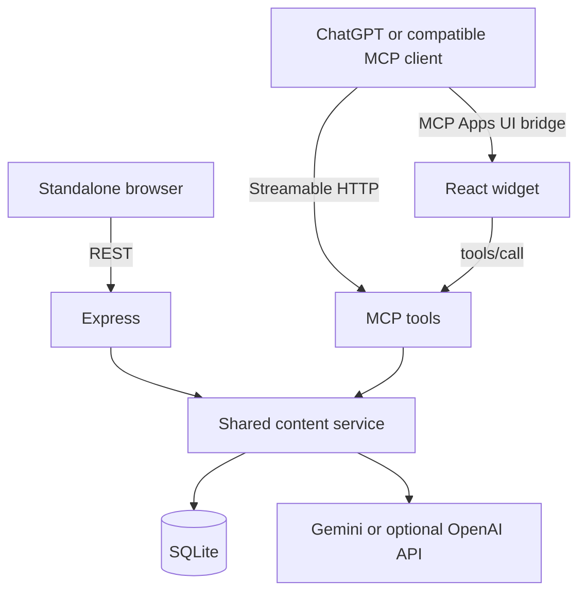

# AI Social Media Content Planner — Content Studio

A portfolio MVP for planning social media posts through a React dashboard and an MCP server. It supports LinkedIn, Instagram and X, stores drafts in SQLite, and schedules drafts locally. It never publishes to social networks.

## Status

The local MCP server is tested with the official TypeScript MCP client. ChatGPT, Claude and Grok live integrations have not been verified. The standalone generation path supports Gemini (preferred) and OpenAI, with explicitly labeled templates when neither key is configured. This is an unauthenticated, single-workspace development MVP; not a production multi-user service.

## Architecture



## Windows setup (PowerShell)

Install Node.js 24 LTS and Git. Open the unzipped project in VS Code:

```powershell
npm ci
Copy-Item .env.example .env
npm run check
npm run build
npm test
npm start
```

Open http://127.0.0.1:3000. Create a brief, write a manual draft or generate three demo templates, edit a draft, then schedule it at a future time. Restart the server to check persistence.

For browser automation: run `npx playwright install chromium` followed by `npm run test:browser`. The test uses a temporary in-memory database and creates screenshots on success. GitHub Actions runs type checking, build, backend/MCP tests and the browser workflow.

Local verification (23 Nov 2026): type checking, production build and all four automated tests passed, including Gemini output validation and provider selection. No live Gemini call was made. Browser execution was blocked by the workspace's Chromium OS socket restriction, and the separate cloud browser could not access the local server. Browser screenshots therefore are not included; the browser test is supplied for a supported environment.

## MCP tools

| Tool | Purpose |
|---|---|
| create_brief | Save business, description, audience, platform, tone, objective |
| save_drafts | Save model-written or manual captions and hashtags |
| generate_drafts | Optional real API generation, otherwise labeled demo templates |
| list_drafts | Retrieve saved briefs and drafts |
| update_draft | Change caption and hashtags |
| schedule_draft | Set a future local calendar date |
| list_calendar | Retrieve scheduled drafts |

The standalone REST adapter uses POST /api/{tool} with the same validated inputs. GET /api/state retrieves the current workspace. GET /health checks availability. The MCP endpoint is POST /mcp using stateless Streamable HTTP. The React HTML bundle is registered as an MCP Apps resource; the UI uses the standard host bridge, not direct network calls in the iframe.

## Testing and actual connector setup

Run `npx @modelcontextprotocol/inspector@latest` after starting the server and choose Streamable HTTP, URL http://127.0.0.1:3000/mcp. Discover all seven tools and call list_drafts.

For a short, public development demonstration, use ONLY synthetic data and a clean temporary database. Do not add a paid API key. A publicly accessible unauthenticated server shares all data with all users; stop the tunnel after testing.

1. Set `PUBLIC_DEMO=true`, `DB_PATH=demo.sqlite` and leave both `GEMINI_API_KEY` and `OPENAI_API_KEY` blank in .env. Restart.
2. Use an HTTPS tunnel (e.g. ngrok http 3000, which may require its own account). Do not expose your personal workspace.
3. In ChatGPT Plugins, select + and Add custom MCP server. Enter the HTTPS URL ending in /mcp, name it Content Studio, and choose no authentication for this disposable demo. Review the warning and create/install the plugin. If your account or administrator does not allow custom MCP servers, this step requires access.
4. In a new chat, select the plugin via @ and prompt: “Create a LinkedIn content brief for fictional Acme AI, aimed at technology managers. Write three professional drafts with hashtags, then ask me before saving them using save_drafts.”
5. Verify the tool call, resource rendering, saved draft in the standalone interface, and persistence. Test editing and scheduling from the widget. Capture screenshots only after you observe success.

Current official workflow: https://developers.openai.com/plugins/build/app-quickstart and https://developers.openai.com/plugins/deploy/connect-chatgpt.

## Optional real AI generation

The host model can write captions and call save_drafts without a separate API key. For standalone AI, create a fresh Gemini key in https://aistudio.google.com/api-keys and set GEMINI_API_KEY in the private .env file. GEMINI_MODEL defaults to gemini-3.8-flash; change it if required by your account's available models. The official Google GenAI SDK requests structured JSON, validates it with Zod, and stores drafts only after successful validation. Check Gemini quotas and pricing at https://ai.google.dev/gemini-api/docs/pricing before enabling. For an optional OpenAI fallback, set OPENAI_API_KEY and OPENAI_MODEL instead; Gemini takes priority when both keys are present. Keep key-enabled usage on loopback with no public tunnel. Neither key should ever be committed to Git.

## Deployment

For a disposable public demo, build and run a Docker image. Use a persistent disk mounted at /data, HTTPS ingress, and no API key. On a Linux VM with Docker:

```sh
docker build -t content-studio .
docker run --rm -p 127.0.0.1:3000:3000 -v planner-demo:/data content-studio
```

Connect an HTTPS reverse proxy or tunnel to port 3000. For managed hosting, choose a Docker-compatible service with a persistent volume and configure its provided PORT. Verify health and MCP tool calls after deployment. Hosting fees and account setup are not included. A production release must add MCP OAuth, per-user data isolation, rate limits, audit logs, and authenticated REST access before public use with real data.

## Claude and Grok

Claude supports remote custom MCP connectors. Connect the disposable HTTPS /mcp URL in Customize > Connectors > Add custom connector; tool compatibility and UI behavior must be tested independently. See https://support.claude.com/en/articles/11175166-get-started-with-custom-connectors-using-remote-mcp.

xAI documents remote MCP tools in its API (https://docs.x.ai/developers/tools/remote-mcp). This does not establish equivalent custom app support in the Grok consumer interface. A separate authenticated API client and live test are needed. Do not claim either integration is verified.

## GitHub

Commit the source, package lock, documentation and screenshots. Never commit .env or SQLite files. Create a new public repository on your account and push the local Git project. The current repository is not yet published.

## Interview notes

MCP standardizes discovery, tool inputs and outputs. The server exposes a common data service to REST and MCP. Zod validates external inputs; SQLite transactions prevent partial batch writes; React renders the same UI standalone and embedded, routing actions through the appropriate transport. The key design distinction is that model-generated captions are stored through tools rather than pretending the MCP server is itself a language model. Describe your actual contribution honestly: this initial implementation was created with AI assistance; personally run, inspect, modify and demonstrate it before stating what you built or tested.
